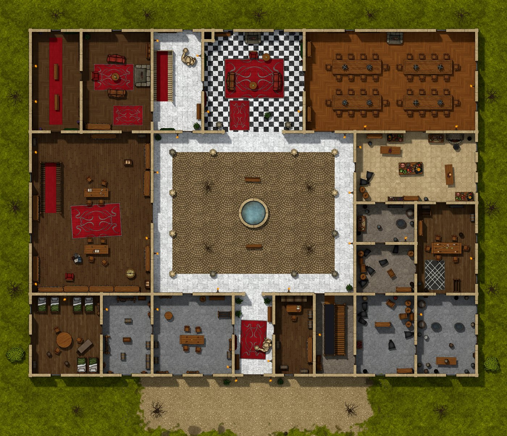
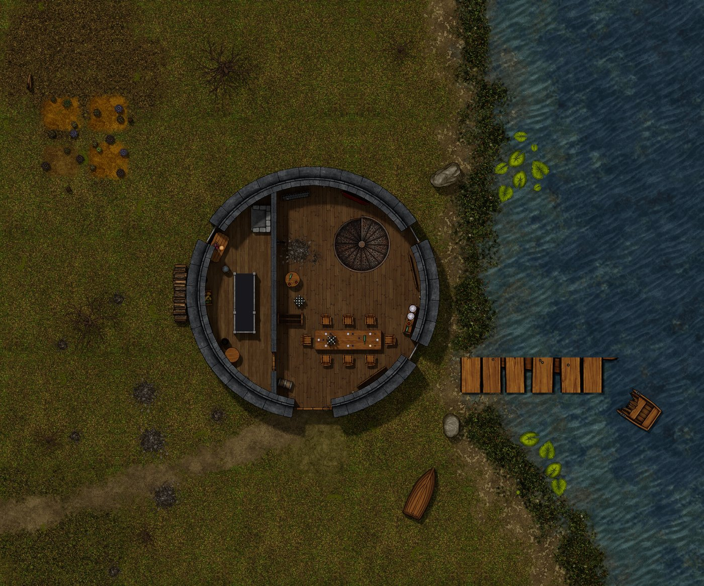
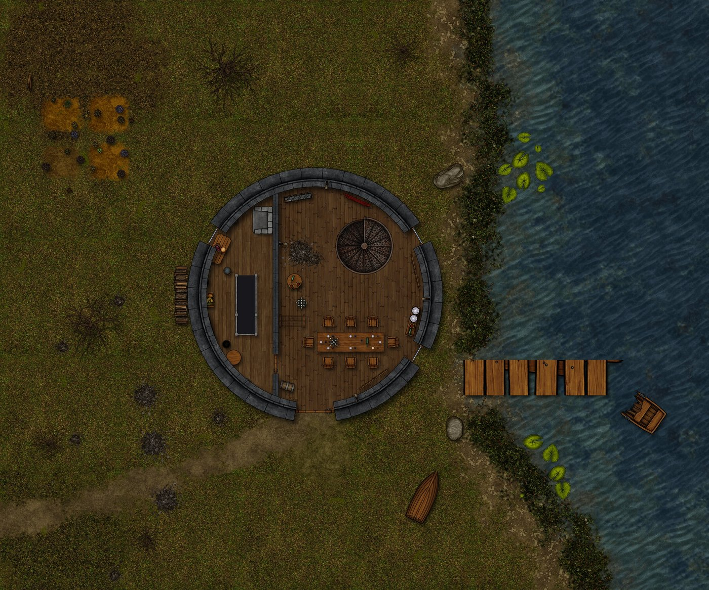
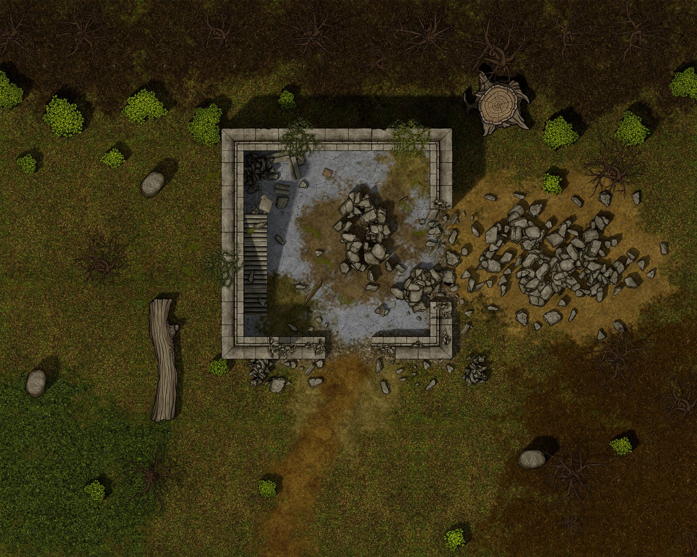
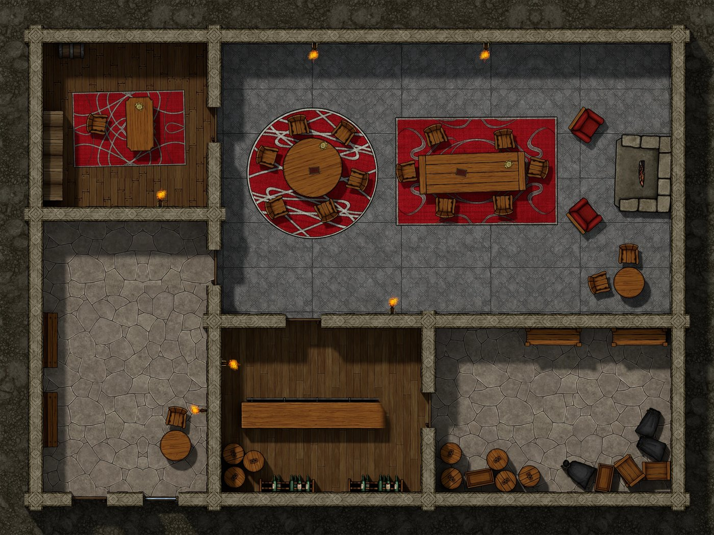
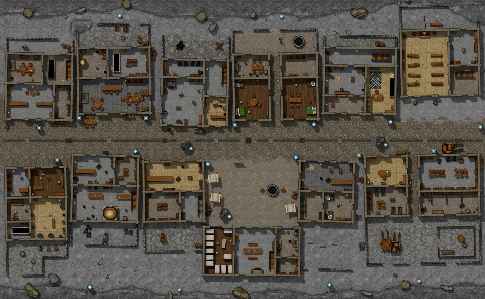
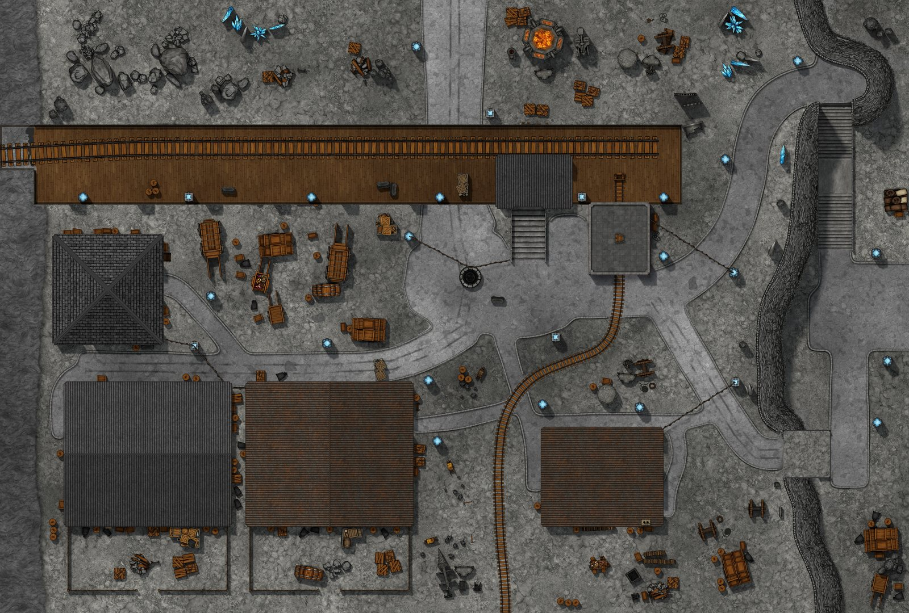
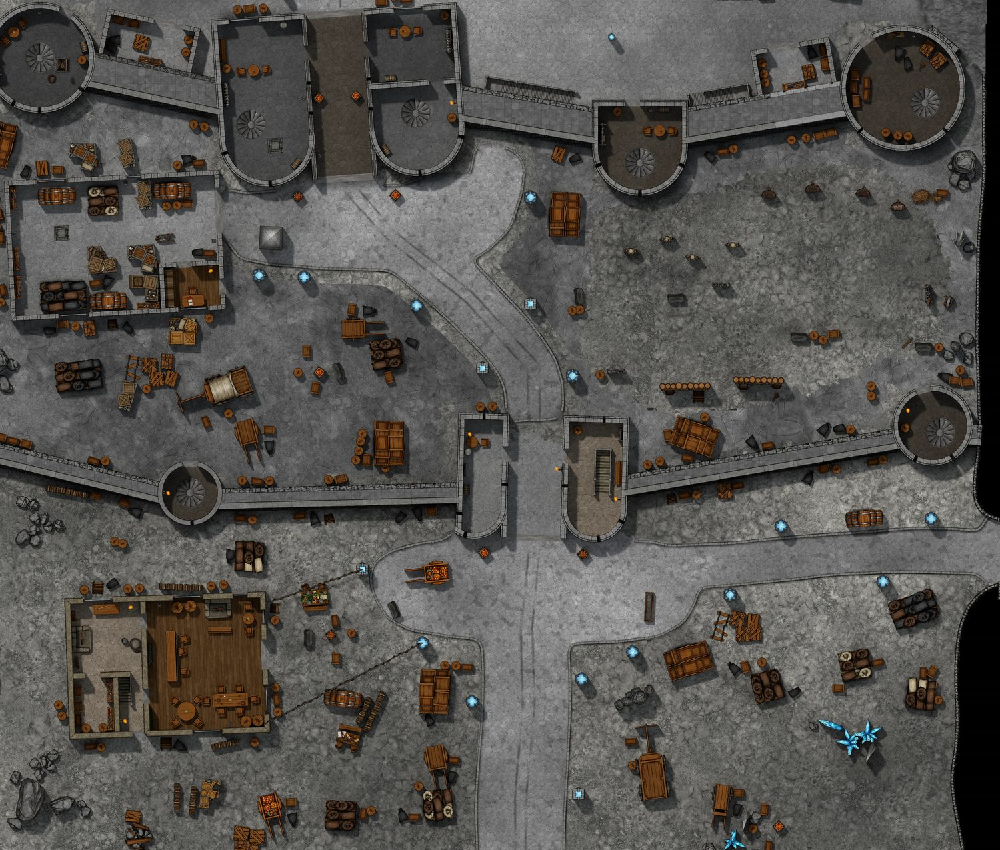

# Zeitgeist Battlemaps


Battlemaps for Foundry VTT where the walls, doors, windows and lights sit exactly on the painted picture.

> A tower on a lake, four floors high over a cellar, and a roof that disappears the moment a token steps inside.



## What it is

A compendium of ready-made scenes. Each map was generated from a plain description of its rooms, doors, windows and furniture, so the painted image and the Foundry data come from the same source. Nothing is traced by hand, which is why a wall never drifts off its line.

The multi-floor maps use Foundry v14 Scene Levels: one scene, one Level per floor, stairs that switch levels, and floors that block sight and light except at the openings. Furniture is placed a little unevenly on purpose, so rooms look lived in rather than laid out with a ruler.

The maps were made for a homebrew campaign and are system-agnostic. They don't need Pathfinder or any other game system.

## Compatibility

Foundry VTT v14, verified on 14.369. The multi-floor scenes need v14's Levels, so older versions aren't supported.

## What's inside

Ten scenes in the **Zeitgeist Battlemaps** compendium. Scene names are in Russian, the language of the campaign they were made for.

| Scene | English name | Size | Floors |
| --- | --- | --- | --- |
| Поместье Изудина | Izudin's manor | 50 × 43 squares | basement, ground, upper, roof |
| Башня у озера | Lake tower | 36 × 30 squares | basement, four floors, roof |
| Башня у озера (2D) | Lake tower, flat painted look | 36 × 30 squares | same as above |
| Руины башни | Ruined tower | 30 × 24 squares | outdoor, one level |
| Руины башни (2D) | Ruined tower, flat painted look | 30 × 24 squares | outdoor, one level |
| Клуб «Шестая Грань» | The Sixth Facet club | 20 × 15 squares | one floor |
| Клуб «Шестая Грань» (2D) | The Sixth Facet club, flat painted look | 20 × 15 squares | one floor |
| Крагмир: улица рабочего квартала | Kragmir, a working-quarter street | 81 × 50 squares | sewer and cellars, street, upper floors, roofs |
| Глубинные шахты: станция | Kragmir deep mines, the station | 80 × 54 squares | lower street, station, upper floors, raised platform, roofs |
| Глубинные шахты: форт | Kragmir deep mines, the fort | 80 × 109 squares | nine levels: below ground, fort, upper floors, wall walk, tower tops, keep top, roofs |

The plain versions are lit with real shadows. The (2D) versions are the same map with a flat painted look and no baked shadows.

## Features

- Walls, doors, windows and lights generated from the same data as the image, so they match to the pixel.
- Every wall runs along a grid line and every door spans whole squares, so tokens walk through doorways without catching on a jamb. No furniture stands inside a wall.
- Doors swing open on their hinges with Foundry's door animation, each one into its room.
- Multi-floor buildings as a single scene, with stairs, balustrades and a pitched roof on its own Level.
- Roofs fade out while any token is inside the building. Courtyards stay open. On the street, each house has a roof of its own.
- Tree crowns are tiles that fade when a token walks under them. Trunks block movement, and so do the rock columns in the street.
- Two town levels in one scene: a cliff with a parapet, a stair and a lift down it, and the lower street seen from above. A raised platform on piers fades over a token beneath it. A token that steps off an edge drops to the level below with a falling-damage card (a damage roll in PF2e).
- Rocks, stacks of crates, carts and machines have object walls on their outline: they stop movement and hide what stands behind them. Rubble and rock heaps are difficult terrain.
- Cellars and shut rooms carry darkness regions, and night lights switch on as the scene darkens.
- Moving parts: drawbridges, lifts, portcullises and pressure plates, with a button on the map for the player whose token stands at the lever or on the lift. The mines station has two lifts: a freight lift down the cliff and a hoist that raises ore carts to the platform.
- Ambient sound on six maps: birds and wind by day, crickets and an owl at night, waves on the lake shore, dripping water, cave air, fires and a working forge. Sounds carry through walls and floors the way Foundry plays them, softer and muffled indoors and upstairs.
- Six macros in the **Zeitgeist Battlemaps: Macros** compendium: **День** sets the open scene to full daylight, **Ночь** to its night value, **Рассвет** and **Закат** to early morning and evening with a warm tint, all fading over ten seconds. **Механизмы** lists the moving parts of the open scene for the GM to operate, reset or jam. **Звуки** lists the scene's sounds, and the GM sets each one to play by the time of day, always, or not at all.

## Installation

In Foundry, open **Add-on Modules**, press **Install Module** and paste this into the manifest field:

```
https://github.com/Zeitcatcher/Zeitgeist-Battlemaps/releases/latest/download/module.json
```

Then enable the module in your world. The zip is about 120 MB because of the map images.

## How to use it

1. Open the **Compendium Packs** sidebar tab and find the **Zeitgeist Battlemaps** folder.
2. Drag a scene into your world, or right-click it and choose **Import**.
3. Activate the scene. On multi-floor maps, switch floors with Foundry's Levels controls.
4. For a night scene, run the **Ночь** macro as the GM. **День** brings the daylight back.
5. Sounds play for tokens: each player hears from their own, and the GM hears through a selected token. Run **Звуки** to switch a map's sounds, and set the ambient volume in the Playlists tab.



## Two looks

Every scene with a (2D) twin comes in both looks. The lit version has shadows under furniture and walls; the flat one is a clean painted map.



## Outdoor maps

The ruined tower shows how outdoor maps work: tree crowns are separate tiles that fade, trunks are walls, and rough ground is marked as difficult terrain.



## Interiors

Rooms are furnished by purpose, and every light, door and window is placed in the Foundry scene as well as painted. The Sixth Facet club has ten lights.



## A street with real houses

The Kragmir street is a whole quarter in one scene: twelve two-storey houses you can walk into, from a tavern and a smithy to a bathhouse and a small temple, around a market square. Under the street runs a sewer with ladder hatches, and one cellar has a hidden way into it. The city sits inside a mountain, so the ground is bare rock and paving, and the light comes from glowing crystals and fires. Each house stands turned a degree or so off the grid, its yard with it, each its own way, and narrow alleys run between them.



## A station on a cliff

The deep mines station of Kragmir stands on a rock shelf 35 feet above the town's lower street, and both are in one scene. A grand stair and a freight lift go down the cliff. The train stops on a raised platform on stone piers, the road to the fort runs under it, and a hoist tower lifts ore carts 25 feet up to the track. Six buildings line the curbed streets: the office, two warehouses, the workers' shed, the hoist tower and the wardens' post where passes are checked. The yards are full of goods, carts, machines and rock fallen from the cave wall.



## A fort across the road

The Kragmir fort holds the road beyond the mines station, 80 by 109 squares and nine levels in one scene. The road passes through an outer wall with a gatehouse, then an inner wall with a twin-towered gate and a working portcullis. Behind it lie a parade ground, barracks, a hall, workshops, a keep and cellars. Wall walks run between the towers, and a token that steps off a wall or a ledge falls to the level below with a damage card. You hear cave air, dripping water, fires, the forge and the anvil; the crowds in the taprooms stay off until the GM turns them on. Pressure plates can spring a trap, and the card they whisper to the GM has its rolls written for PF2e, so other systems show them as raw text.



## Credits

Maps by Zeitcatcher.

**Artwork: Forgotten Adventures.** These maps were created using assets from [Forgotten Adventures](https://www.forgotten-adventures.net) (www.forgotten-adventures.net). All of that artwork remains the property of Forgotten Adventures and is used under their Fan-Content License. If you like these maps, support the artists at Forgotten Adventures. This module is not made, endorsed or approved by Forgotten Adventures.

Only rendered map images ship in this module. The original asset files are not included and can't be taken out of the maps.

**Textures and models: Poly Haven.** The lit versions use CC0 materials and models from [Poly Haven](https://polyhaven.com).

**Sounds: Freesound.** The ambient loops are cut from CC0 recordings on [Freesound](https://freesound.org): [birds in a forest](https://freesound.org/people/BurghRecords/sounds/490846/) by BurghRecords, [crickets and a tawny owl](https://freesound.org/people/raoul_slayer/sounds/203598/) by raoul_slayer, [small waves](https://freesound.org/people/robotjay/sounds/518467/) by robotjay, [drops in a cave](https://freesound.org/people/Selector/sounds/402929/) by Selector [cave ambience](https://freesound.org/people/pointlessperson1/sounds/740041/) by pointlessperson1, [a hearth fire](https://freesound.org/people/nielstii/sounds/346321/) by nielstii, [a campfire](https://freesound.org/people/Spandau/sounds/40699/) by Spandau, [hand bellows](https://freesound.org/people/Artiom_Constantinov/sounds/856539/) by Artiom_Constantinov and [a tavern crowd](https://freesound.org/people/denkmal/sounds/539811/) by denkmal. The anvil comes from a [blacksmith recording](https://freesound.org/people/bruno.auzet/sounds/640197/) by bruno.auzet. The trap sound is cut from the same blacksmith recording and a [hot spring](https://freesound.org/people/Nox_Sound/sounds/829623/) by Nox_Sound.

The maps are built with Blender and a custom generator.

## License


Free for any noncommercial use under the [PolyForm Noncommercial License 1.0.0](LICENSE). You can use, modify and share the maps for your own games, but you can't sell them. The Forgotten Adventures artwork inside them keeps its own license and terms, which this one doesn't widen.
