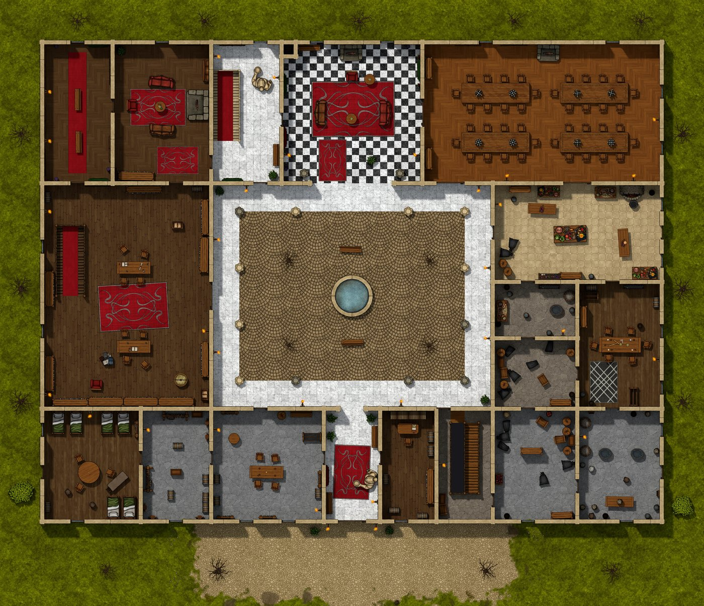
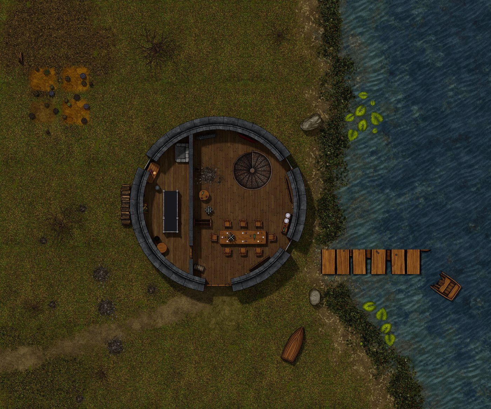
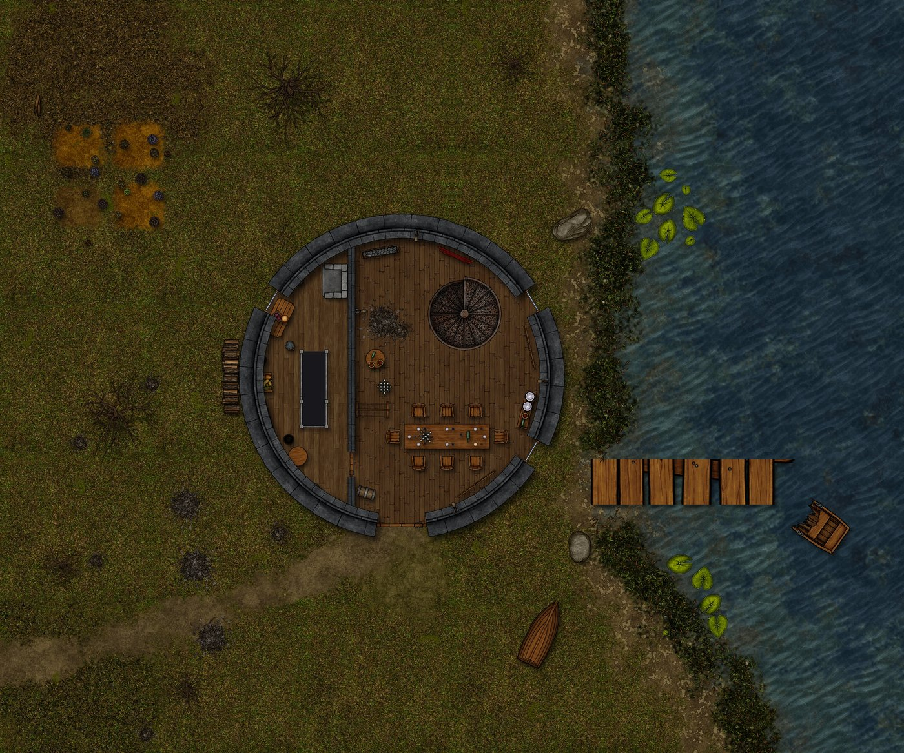
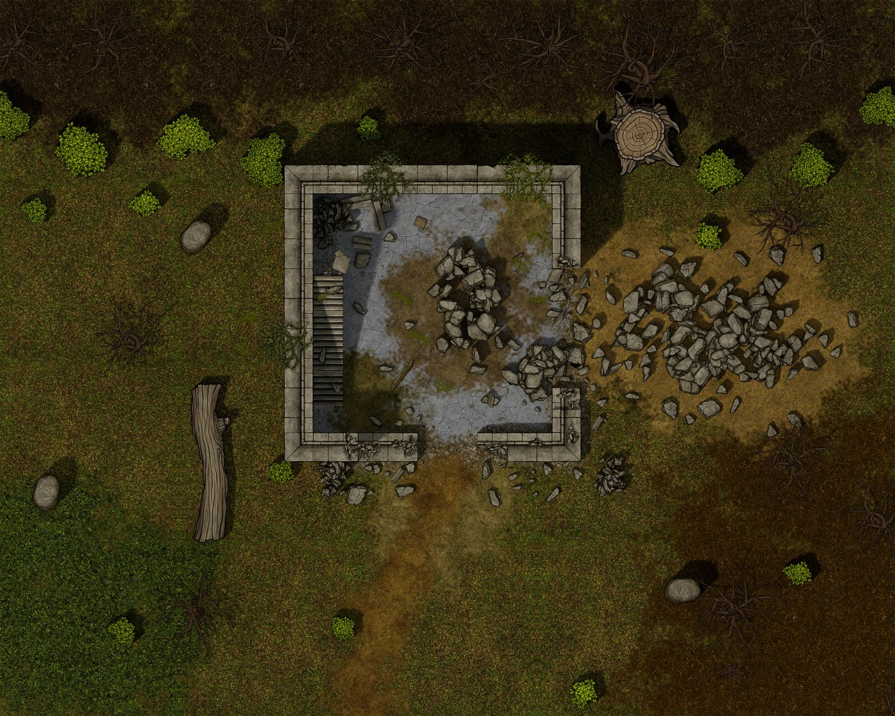
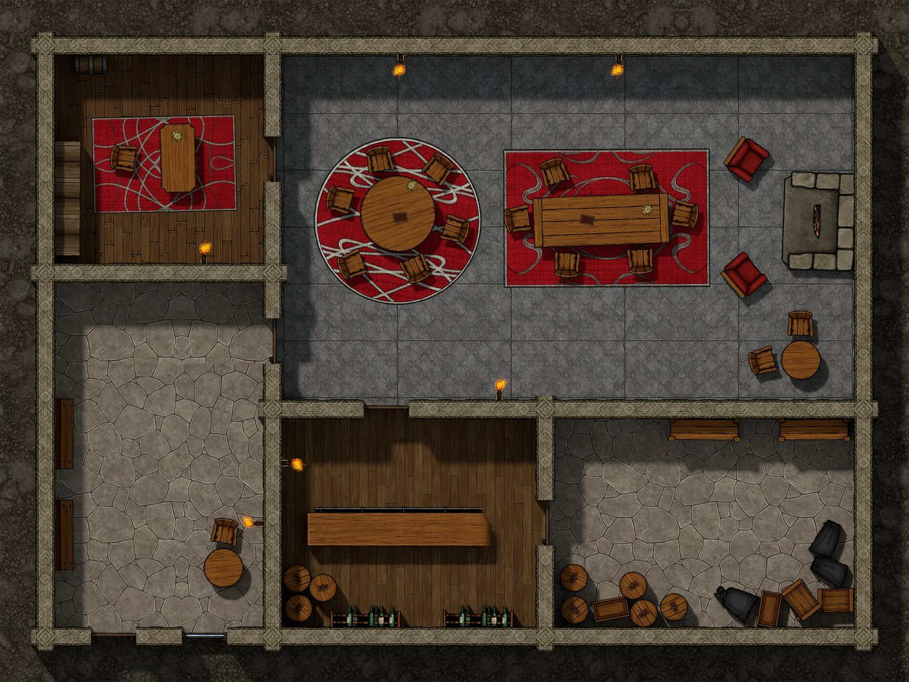
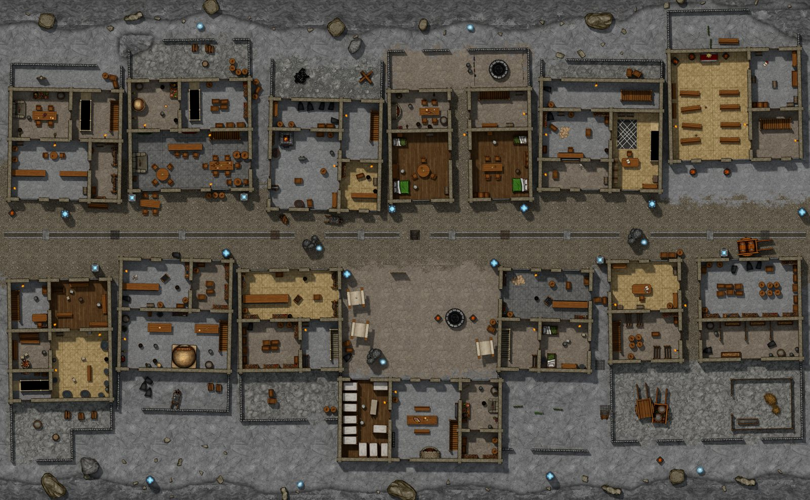

# Zeitgeist Battlemaps


Battlemaps for Foundry VTT where the walls, doors, windows and lights sit exactly on the painted picture.

> A tower on a lake, four floors high over a cellar, and a roof that disappears the moment a token steps inside.



## What it is

A compendium of ready-made scenes. Each map was generated from a plain description of its rooms, doors, windows and furniture, so the painted image and the Foundry data come from the same source. Nothing is traced by hand, which is why a wall never drifts off its line.

The multi-floor maps use Foundry v14 Scene Levels: one scene, one Level per floor, stairs that switch levels, and floors that block sight and light except at the openings. Furniture is placed a little unevenly on purpose, so rooms look lived in rather than laid out with a ruler.

The maps were made for a homebrew campaign and are system-agnostic. They don't need Pathfinder or any other game system.

## Compatibility

Foundry VTT v14, verified on 14.367. The multi-floor scenes need v14's Levels, so older versions aren't supported.

## What's inside

Eight scenes in the **Zeitgeist Battlemaps** compendium. Scene names are in Russian, the language of the campaign they were made for.

| Scene | English name | Size | Floors |
| --- | --- | --- | --- |
| Поместье Изудина | Izudin's manor | 50 × 43 squares | basement, ground, upper, roof |
| Башня у озера | Lake tower | 36 × 30 squares | basement, four floors, roof |
| Башня у озера (2D) | Lake tower, flat painted look | 36 × 30 squares | same as above |
| Руины башни | Ruined tower | 30 × 24 squares | outdoor, one level |
| Руины башни (2D) | Ruined tower, flat painted look | 30 × 24 squares | outdoor, one level |
| Клуб «Шестая Грань» | The Sixth Facet club | 20 × 15 squares | one floor |
| Клуб «Шестая Грань» (2D) | The Sixth Facet club, flat painted look | 20 × 15 squares | one floor |
| Крагмир: улица рабочего квартала | Kragmir, a working-quarter street | 81 × 50 squares | sewer and cellars, street, upper floors, roofs |

The plain versions are lit with real shadows. The (2D) versions are the same map with a flat painted look and no baked shadows.

## Features

- Walls, doors, windows and lights generated from the same data as the image, so they match to the pixel.
- Every wall runs along a grid line and every door spans whole squares, so tokens walk through doorways without catching on a jamb. No furniture stands inside a wall.
- Multi-floor buildings as a single scene, with stairs, balustrades and a pitched roof on its own Level.
- Roofs fade out while any token is inside the building. Courtyards stay open. On the street, each house has a roof of its own.
- Tree crowns are tiles that fade when a token walks under them. Trunks block movement, and so do the rock columns in the street.
- Cellars and shut rooms carry darkness regions, and night lights switch on as the scene darkens.
- Two macros in the **Zeitgeist Battlemaps: Macros** compendium: **День** sets the open scene to full daylight, **Ночь** to its night value, both fading over ten seconds.

## Installation

In Foundry, open **Add-on Modules**, press **Install Module** and paste this into the manifest field:

```
https://github.com/Zeitcatcher/Zeitgeist-Battlemaps/releases/latest/download/module.json
```

Then enable the module in your world. The zip is about 75 MB because of the map images.

## How to use it

1. Open the **Compendium Packs** sidebar tab and find the **Zeitgeist Battlemaps** folder.
2. Drag a scene into your world, or right-click it and choose **Import**.
3. Activate the scene. On multi-floor maps, switch floors with Foundry's Levels controls.
4. For a night scene, run the **Ночь** macro as the GM. **День** brings the daylight back.



## Two looks

Every scene with a (2D) twin comes in both looks. The lit version has shadows under furniture and walls; the flat one is a clean painted map.



## Outdoor maps

The ruined tower shows how outdoor maps work: tree crowns are separate tiles that fade, trunks are walls, and rough ground is marked as difficult terrain.



## Interiors

Rooms are furnished by purpose, and every light, door and window is placed in the Foundry scene as well as painted. The Sixth Facet club has ten lights.



## A street with real houses

The Kragmir street is a whole quarter in one scene: twelve two-storey houses you can walk into, from a tavern and a smithy to a bathhouse and a small temple, around a market square. Under the street runs a sewer with ladder hatches, and one cellar has a secret way into it. The city sits inside a mountain, so the ground is bare rock and paving, and the light comes from glowing crystals and fires. Each house stands turned a degree or so off the grid, its yard with it, each its own way, and narrow alleys run between them.



## Credits

Maps by Zeitcatcher.

**Artwork: Forgotten Adventures.** These maps were created using assets from [Forgotten Adventures](https://www.forgotten-adventures.net) (www.forgotten-adventures.net). All of that artwork remains the property of Forgotten Adventures and is used under their Fan-Content License. If you like these maps, support the artists at Forgotten Adventures. This module is not made, endorsed or approved by Forgotten Adventures.

Only rendered map images ship in this module. The original asset files are not included and can't be taken out of the maps.

**Textures and models: Poly Haven.** The lit versions use CC0 materials and models from [Poly Haven](https://polyhaven.com).

The maps are built with Blender and a custom generator.

## License


Free for any noncommercial use under the [PolyForm Noncommercial License 1.0.0](LICENSE). You can use, modify and share the maps for your own games, but you can't sell them. The Forgotten Adventures artwork inside them keeps its own license and terms, which this one doesn't widen.
